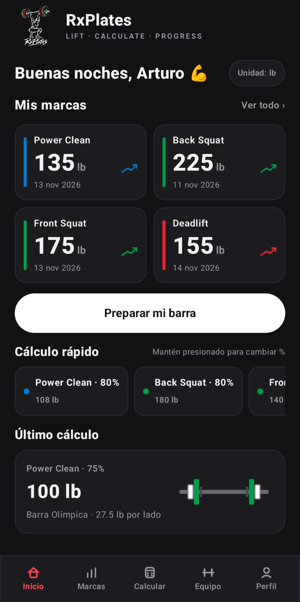

# RxPlates

Aplicación Android para atletas de CrossFit y halterofilia. Surgió de una necesidad que identifiqué durante mis entrenamientos: convertir una marca personal en una carga de trabajo y saber qué discos poner en cada lado de la barra.

## Funciones

- Registra y consulta marcas personales por ejercicio.
- Calcula cargas a partir de un peso objetivo o un porcentaje de 1RM.
- Muestra los discos por lado según la barra y el inventario disponibles. Si el inventario impide alcanzar el objetivo exacto, propone la carga alcanzable más cercana por debajo.
- Gestiona barras y discos, convierte entre libras y kilogramos y guarda el perfil del atleta.

## Mi contribución

Propuse la aplicación, definí sus funciones y la lógica de las cargas y diseñé las interfaces en Figma. Colaboré en el desarrollo asistido por IA, la integración y las pruebas funcionales en Android Studio.

## Estado del proyecto

Cuenta con una versión instalable mediante APK para pruebas. La app guarda el perfil, las marcas y el inventario en el dispositivo con Room y SQLite.

## Pantalla de inicio

La pantalla reúne las marcas recientes, los porcentajes de cálculo rápido y el resultado del último armado de barra.
